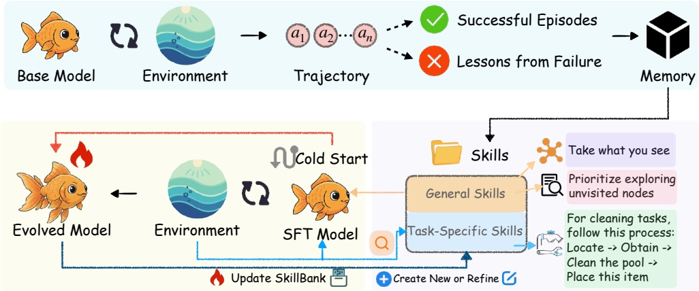
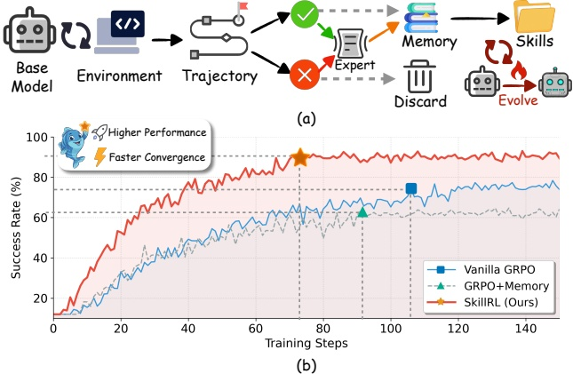
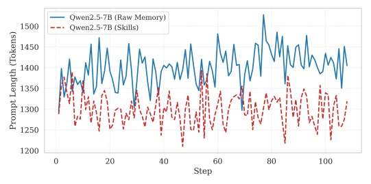
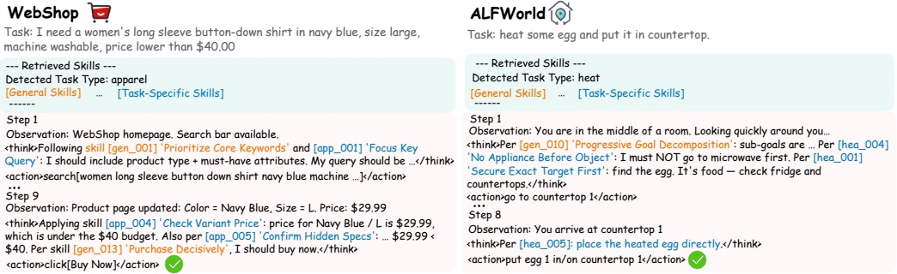
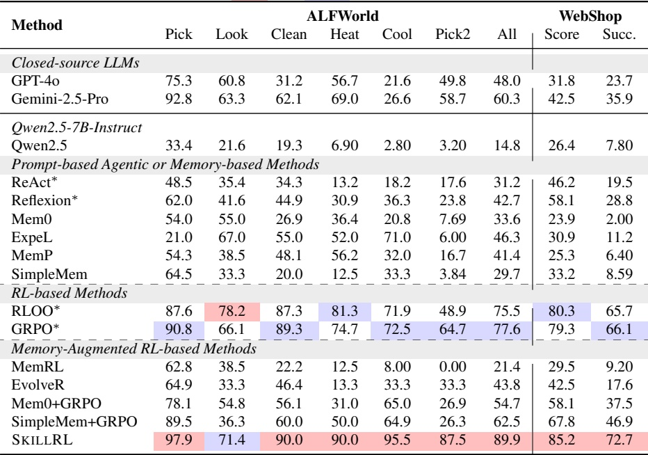

# SKILLRL 精读学习笔记

> **论文**：SKILLRL: Evolving Agents via Recursive Skill-Augmented Reinforcement Learning
> **作者**：Peng Xia, Jianwen Chen, Hanyang Wang 等（UNC-Chapel Hill / UChicago / UCSD / NEC Labs / UC Berkeley / UC Santa Cruz）
> **发表**：NeurIPS 2026 · arXiv: [2602.08234](https://arxiv.org/abs/2602.08234)
> **代码**：[github.com/aiming-lab/SkillRL](https://github.com/aiming-lab/SkillRL)
> **笔记来源**：基于与 Codex (gpt-6-thinking) 的 47 轮对话整理，保留全部 14 个学习疑惑点及解答

---

## 目录

1. [论文整体预览](#1-论文整体预览)
2. [三篇论文对比：SKILLRL vs A-Mem vs Agent0](#2-三篇论文对比)
3. [Introduction 精读：背景与研究动机](#3-introduction-精读)
4. [核心概念辨析：微调、Policy、SkillBank](#4-核心概念辨析)
5. [两条机制的串行与并行关系](#5-两条机制的串行与并行关系)
6. [Figure 2 框架详解与 GRPO 算法](#6-figure-2-框架详解与-grpo)
7. [GRPO 的奖励从哪里来？评价体系详解](#7-grpo-的奖励从哪里来)
8. [SFT 公式详解：θsft = arg min LCE](#8-sft-公式详解)
9. [搜索增强问答实验与 Table 2](#9-搜索增强问答实验)
10. [实验 6 拆解：WebShop 与 ALFWorld](#10-实验-6-拆解)
11. [完整训练流程：从具体任务到数学实例](#11-完整训练流程)
12. [教师模型的角色与 SFT 的必要性](#12-教师模型的角色与-sft-的必要性)
13. [论文不足与学习建议](#13-论文不足与学习建议)

---

## 1. 论文整体预览

> **❓ 我的疑问**：先做一下整体预览

### 一句话概括

**SKILLRL 让 Agent 不再只是完成任务，而是能够从过去的成功与失败中总结技能（Skills），再通过强化学习不断改进自身的行为策略和技能库。**

这篇论文研究的是 **Self-Evolving Agents（自进化智能体）**，将 Agent Memory、Agent Skills 和 Reinforcement Learning 三个方向结合。

### 作者发现了什么问题？

传统 Agent 存在一个明显问题：假设让 Agent 连续完成 100 个不同任务，它可能在第 10 个任务中犯过一次错误，但到第 80 个类似任务时仍然重复同样的错误。

此前两种解决思路：
- **Memory-based Agent**：保存历史轨迹，遇到相似任务时检索参考
- **RL-based Agent**：通过强化学习调整模型参数

但作者认为：**仅仅保存历史轨迹 ≠ 真正掌握解决问题的方法。** 原始轨迹可能很长、充满冗余，甚至包含错误动作。Agent 应当学习能跨任务复用的行动原则，而非机械记忆。

### SKILLRL 整体设计



> **Figure 2**（论文第 3 页）：SKILLRL 整体框架。Base Model 在环境中执行任务收集轨迹 → 教师模型蒸馏为技能 → Cold-Start SFT → GRPO + 技能递归进化。

```
Base Agent + Environment
    ↓ 执行大量任务，收集成功与失败轨迹
Experience Distillation（经验蒸馏）
    ↓ 教师模型将轨迹提炼为可复用经验规则
SKILLBANK（分层技能库）
    ├─ General Skills（通用技能）
    └─ Task-Specific Skills（任务专用技能）
    ↓
Cold-Start SFT + GRPO
    ↓ 先教会模型使用技能，再通过 RL 优化策略
Recursive Skill Evolution
    ↓ 验证失败 → 发现缺失技能 → 更新 SKILLBANK → 继续训练
    └─ 循环进化
```

> ⚠️ 论文里的「进化」主要发生在**训练过程中**：每经过若干验证步骤，系统分析失败轨迹并更新技能库。不是指部署后 Agent 每完成一个任务就自动更新权重。

### 三个核心创新机制

| 机制 | 解决的问题 | 方法 |
|---|---|---|
| M1：Experience-based Skill Distillation | 原始轨迹冗长、噪声多 | 将成功经验和失败教训提炼成简洁可执行的 Skills |
| M2：Hierarchical SKILLBANK | 技能太多如何找到有用的 | 分通用/专用两层，自适应检索 |
| M3：Recursive Skill Evolution | 静态技能库无法覆盖新问题 | 验证失败 → 动态生成/优化技能，与 RL 共同进化 |

递进关系：**先学会总结经验 → 再学会使用经验 → 最后让经验和模型共同进化。**

### 简单例子

Agent 在网页购物中第一次失败（没检查规格价格变化）：

| 传统 Memory Agent | SKILLRL |
|---|---|
| 记住完整购物过程 | 提炼出 Skill：「Check Variant Pricing — 商品存在规格选项时，先选属性再确认价格」|
| 下次检索历史轨迹模仿 | 技能可直接应用在不同商品上 |

### 实验效果



> **Figure 1**（论文第 2 页）：SKILLRL pipeline 概览。(a) 与传统方法的对比——传统方法保存原始轨迹（灰色虚线），SKILLRL 提炼可复用技能并递归进化。(b) ALFWorld 验证集成功率：SKILLRL（红，~90%）vs Vanilla GRPO（蓝，~75%）vs GRPO+Memory（灰虚线，~62%）。


> **Figure 5**（论文第 8 页）：有/无技能进化的成功率对比。w/ Skills Evolution（红虚线，收敛 ~0.88）vs w/o（蓝实线，~0.76），证明递归技能进化显著加速收敛。



> **Figure 4**（论文第 8 页）：Prompt token 长度对比。Raw Memory（蓝实线，~1450 tokens）vs Skills（红虚线，~1300 tokens），技能抽象显著减少 context 消耗。



> **Figure 3**（论文第 8 页）：技能库在 RL 训练过程中的规模变化，从初始 ~55 个技能增长到 ~100 个。



> **Table 1**（论文第 6 页）：ALFWorld 各任务类型的成功率对比，SKILLRL 在多数任务类型上达到 SOTA。

- 基础模型：Qwen2.5-7B-Instruct，GRPO 训练
- ALFWorld 相比 GRPO +12.3pp；WebShop +6.6pp
- 消融：去掉动态技能进化 89.9%→84.4%；去掉 Cold-Start SFT →65.2%
- **Cold-Start SFT 作用很大，动态技能进化提供进一步收益**

---

## 2. 三篇论文对比

> **❓ 我的疑问**：agent0 与 A mem 以及 skillRL，这三篇论文哪个更适合我去看

**结论：精读一篇选 SKILLRL；最快上手做实验选 A-Mem；Agent0 放最后。**

| 对比 | A-Mem | SKILLRL | Agent0 |
|---|---|---|---|
| 主要领域 | Agent Memory | Agent Skills + RL | Self-Evolving Agent |
| 核心问题 | 如何组织和更新记忆 | 如何从经验中学习技能 | 如何自主生成任务并持续学习 |
| 核心方法 | 动态记忆链接与演化 | 技能蒸馏、分层检索、GRPO | 课程 Agent 与执行 Agent 共同进化 |
| 是否训练模型 | ❌ 不需要 | ✅ 需要 | ✅ 需要 |
| 入门难度 | 低 | 中 | 较高 |
| 发表venue | NeurIPS 2025 | NeurIPS 2026 | preprint（投 ICML/COLM'26） |

### 建议学习路线

1. **先快速阅读 A-Mem** — 理解 Agent Memory 的存储、检索、链接与演化，可用 API 或小模型运行
2. **然后重点精读 SKILLRL** — 主要学习任务，关注 SkillBank 为什么优于普通记忆、SFT 为什么必要、RL 如何和动态 SkillBank 配合
3. **最后研究 Agent0** — 理解 RL 和自进化框架后，重点学习 Curriculum Agent + Executor Agent 设计

### 复现成本

- A-Mem：支持 OpenAI API/Ollama/vLLM，不必训练模型
- SKILLRL：8×H100 80GB，单次约 30 小时；可先复现技能检索模块
- Agent0：课程生成 + 双 Agent + 代码沙箱 + VeRL，工程链路最长

---

## 3. Introduction 精读

> **❓ 我的疑问**：请你讲解 skillrl 的 Introduction，包括引用的相关工作，我是 agent 新手

### 第一段：Agent 很强，但缺少持续学习能力

**LLM vs LLM Agent 的区别**：
- LLM 根据输入上下文生成输出
- LLM Agent 能利用模型决策，通过工具与外部环境交互

经典 Agent 交互范式（ReAct, ICLR 2023）：
```
Thought → Action → Observation → Thought → Action → ...
```

论文真正指出的问题——**Episodic（回合制）**：每个任务独立执行，不同 Episode 之间无法有效传递经验。

> Agent 在 Episode 2 发现某种 PDF 下载方式失效，却没有保存这条经验，Episode 4 就可能重复犯错。

核心研究问题：**如何让 Agent 高效地从历史经验中学习，并将知识迁移到其他任务？**

### 第二段：为什么传统 Agent Memory 不够？

**Trajectory（轨迹）** = Agent 完成一次任务的完整交互过程：
$$\tau = (o_0, a_0, r_0, o_1, a_1, r_1, \ldots, o_T, a_T, r_T)$$

| 符号 | 含义 | 示例 |
|---|---|---|
| $o_t$ | Observation，环境观察 | 搜索返回了 5 个网页 |
| $a_t$ | Action，执行动作 | 点击第 2 个链接 |
| $r_t$ | Reward，奖励信号 | 任务完成，获得奖励 1 |

传统 Memory 保存原始轨迹的问题：
- **Redundancy（冗余）**：大量重复、无关信息
- **Noise（噪声）**：错误、误导性内容

作者要解决的不是"怎么把记忆压缩更短"，而是：**怎么让经验的信息密度更高、指导性更强，并能迁移到不同任务。**

### 相关工作脉络

```
2023 · 反思与经验学习
  ReAct → Reflexion / ExpeL
  执行任务、总结失败、复用经验

2025 · 结构化记忆
  Mem0 等记忆系统
  提取、存储、检索、维护长期记忆

2025-2026 · 记忆与技能自进化
  SKILLRL（本文）
  从经验提炼技能 → RL 共同进化
```

---

## 4. 核心概念辨析

> **❓ 我的疑惑**：微调是指把 RL 网络训练出来了，还是把小模型后训练了一下？

**SKILLRL 不是额外训练了一个独立的 RL 网络，而是对原有的小参数量 LLM 进行后训练（Post-training）。**

基础模型：**Qwen2.5-7B-Instruct**（70 亿参数），通过两个阶段更新参数：

| 阶段 | 方法 | 作用 |
|---|---|---|
| Cold-Start SFT | 监督微调 | 让 Qwen 学会使用 SkillBank 中的技能 |
| GRPO | 强化学习 | 根据任务奖励优化决策策略 |

> **❓ 我的疑惑**：「优化决策策略」是指 policy 函数以及 skill 的提炼与更新机制吗？

**Policy** 专指 LLM 本身（$\pi_\theta$），即 Qwen 如何选择下一步动作。SkillBank 的提炼与更新是**独立的外部知识管理**，不通过梯度更新。

- **Policy 更新**：SFT → GRPO 更新 $\theta$（梯度下降）
- **SkillBank 更新**：教师模型分析失败轨迹 → 增加或完善技能（非梯度）
- **"共同进化"** 指两者在训练循环中交替更新，不是同一个优化过程

---

## 5. 两条机制的串行与并行关系

> **❓ 我的疑惑**：这两条策略的串行与并行关系是什么？

```
Step 1: 经验收集 → 教师蒸馏 → SkillBank 初始化     [串行]
Step 2: Cold-Start SFT → Qwen 学会使用技能          [串行]
Step 3: GRPO 训练循环                                [交替]
    ├─ Policy 更新（每步）
    └─ SkillBank 更新（每隔若干步验证后）            [交替执行，非并行]
```

**交替而非并行的原因**：SkillBank 更新需要先验证当前 Policy 的表现，分析失败轨迹才能发现缺失技能。这是一个因果关系：先有失败 → 才能总结新技能 → 再用新技能指导后续训练。

**有并行的部分**：在一个 GRPO 训练步内，Policy 的梯度更新和轨迹采样是并行的（多条轨迹同时采样），但 SkillBank 在此期间不变。

---

## 6. Figure 2 框架详解与 GRPO

> **❓ 我的疑问**：请你讲解 Figure 2 以及什么是 GRPO

### Figure 2 三阶段


> **Figure 2**（论文第 3 页）：完整训练框架，包含经验收集蒸馏、Cold-Start SFT、GRPO + 技能进化循环三个阶段。

**第一阶段：从 Trajectory 提炼 Skill**

Base Model（Qwen）在环境中执行任务 → 产生成功/失败轨迹 → 教师模型分析：
- 成功轨迹 → 提取有效策略
- 失败轨迹 → 总结失败教训

蒸馏为 General Skills（如"优先探索未访问区域"）和 Task-Specific Skills（如"清洗任务按定位→获取→清洗→放置顺序"）。

> ⚠️ 这一步主要由教师模型负责，不涉及 GRPO。

**第二阶段：Cold-Start SFT**

SKILLBANK 有了技能后，直接告诉原始 Qwen，它不一定知道如何正确使用。因此用 SFT：教师模型生成示范轨迹（展示如何选技能、做决策）→ 微调 Qwen。

$$\theta_{\text{base}} \xrightarrow{\text{SFT}} \theta_{\text{sft}}$$

**第三阶段：GRPO + Skill Evolution 循环**

- 每轮：模型检索 Skills → 执行任务 → GRPO 更新参数
- 每隔若干步：验证 → 教师分析失败 → 更新 SkillBank

$$\boxed{\text{Policy: } \theta_t \to \theta_{t+1} \quad \text{SkillBank: } S_t \to S_{t+1}}$$

### GRPO 是什么？

**Group Relative Policy Optimization（群体相对策略优化）**，DeepSeekMath (2024) 提出。

**核心思想**：让模型对同一任务采样多条轨迹，比较哪些更成功，调整参数让它更倾向产生成功行为。

**具体计算**：假设 4 条轨迹奖励 $R = [1, 1, 0, 0]$

$$\bar{R} = 0.5, \quad \sigma_R = 0.5$$

$$A_i = \frac{R_i - \bar{R}}{\sigma_R}$$

| 轨迹 | 奖励 $R_i$ | 优势 $A_i$ | 训练方向 |
|---|---:|---:|---|
| 1 | 1 | +1 | 鼓励 |
| 2 | 1 | +1 | 鼓励 |
| 3 | 0 | −1 | 抑制 |
| 4 | 0 | −1 | 抑制 |

**GRPO 不需要额外训练 Critic 网络**，直接用组内相对奖励估计优势。

### GRPO 公式

$$\mathcal{J}_{\text{GRPO}}(\theta) = \mathbb{E}_{x,\{y_i\}} \left[ \frac{1}{G} \sum_{i=1}^{G} \min(r_i A_i, \text{clip}(r_i, 1-\epsilon, 1+\epsilon) A_i) - \beta D_{\text{KL}}(\pi_\theta \| \pi_{\text{ref}}) \right]$$

| 部分 | 含义 |
|---|---|
| $G$ | 采样轨迹数（SKILLRL 中 Group Size = 8） |
| $A_i$ | 组内相对优势 |
| $r_i$ | 新旧策略概率比 $\frac{\pi_\theta(y_i\|x)}{\pi_{\text{old}}(y_i\|x)}$ |
| $\text{clip}$ | 限制策略更新幅度（PPO 经典技巧） |
| $D_{\text{KL}}$ | KL 正则项，防止策略偏离太远 |

### GRPO vs PPO

| | PPO | GRPO |
|---|---|---|
| Actor | ✅ 策略网络 | ✅ Policy LLM |
| Critic | ✅ 价值网络 | ❌ 不需要 |
| 优势估计 | 学习型价值函数 | 组内奖励比较 |
| 训练成本 | 需训练 Critic | 省去 Critic，但需多采样 |

---

## 7. GRPO 的奖励从哪里来

> **❓ 我的疑惑**：GRPO 的奖励怎么得到？经典 PPO 有评价网络辅助判断，GRPO 的评价体系怎么判断？靠人吗？

### 关键区分

- **Reward（奖励）**：告诉模型一次行为获得多少分
- **Critic（价值网络）**：估计某状态下未来可能获得多少奖励，帮助计算 Advantage

PPO 的 Critic ≠ 最终任务评分器。GRPO 用组内相对评分替代了学习型 Critic，但**仍需要外部奖励信号**。

### SKILLRL 的奖励

$$\boxed{R_i = r(\tau^{(i)}) \in \{0, 1\}}$$

**二元任务成功奖励**：$R=1$ 成功，$R=0$ 失败。不靠人类逐条评价，而是**任务环境提供成功/失败反馈**。

例如 ALFWorld 中，环境根据目标状态判断任务是否真正完成（物品是否清洗后放到了指定位置），不需要 LLM 裁判主观打分。

> **环境可验证的奖励往往比语言模型主观判断更可靠。**

### 奖励类型对比

| Agent 类型 | 奖励来源 | 可靠性 |
|---|---|---|
| ALFWorld / WebShop | 环境规则判定 | 高（确定性） |
| 数学推理 | 答案正确性验证 | 高 |
| 开放对话 | 人类标注 / RLHF 奖励模型 | 中（有偏差） |
| 创意写作 | LLM-as-Judge | 低（主观） |

### ⚠️ Reward Hacking 风险

如果奖励设计不准确，模型可能学到"钻空子"——获得高奖励但没真正完成任务。GRPO 不能解决这个问题，它只是优化方式不同，奖励质量仍然是根本。

作者选择 GRPO 的原因：**省去 Critic 训练成本**，在环境可验证奖励的场景下足够可靠。

---

## 8. SFT 公式详解

> **❓ 我的疑惑**：$\theta_{\text{sft}} = \arg\min_\theta \mathcal{L}_{\text{CE}}(\mathcal{D}_{\text{SFT}}; \theta)$ 是什么含义？

### 公式拆解

| 符号 | 含义 |
|---|---|
| $\theta$ | LLM 的参数 |
| $\theta_{\text{sft}}$ | SFT 训练后的最优参数 |
| $\arg\min_\theta$ | 找到使损失最小的 $\theta$ |
| $\mathcal{L}_{\text{CE}}$ | 交叉熵损失（Cross-Entropy Loss） |
| $\mathcal{D}_{\text{SFT}}$ | SFT 训练数据集 |

**含义**：在 SFT 训练数据 $\mathcal{D}_{\text{SFT}}$ 上，找到使交叉熵损失最小的模型参数 $\theta$。

### 交叉熵损失

对于一条训练样本（输入 $x$，目标输出 $y$）：

$$\mathcal{L}_{\text{CE}} = -\sum_t \log P_\theta(y_t | y_{<t}, x)$$

即：让模型生成目标输出 $y$ 的概率尽可能大。

### SKILLRL 的 SFT 训练

1. 教师模型生成示范轨迹：展示如何根据任务选择技能、根据技能做决策
2. 这些轨迹构成 $\mathcal{D}_{\text{SFT}}$
3. 用 $\mathcal{L}_{\text{CE}}$ 微调 Qwen，让它学会"看到任务 → 检索技能 → 使用技能做决策"的模式

### SFT vs GRPO

| | SFT | GRPO |
|---|---|---|
| 数据 | 教师示范（标准答案） | 自己采样的轨迹（有成功有失败） |
| 信号 | 模仿正确行为 | 相对优势（好的多做，坏的少做） |
| 损失 | 交叉熵 | 策略梯度 + KL 正则 |
| 阶段 | Cold-Start（先学会用技能） | RL（再优化决策） |

---

## 9. 搜索增强问答实验

> **❓ 我的疑惑**：搜索增强问答任务的性能数据集介绍一下，以及完整实验设置

### 什么是 Search-Augmented QA

Agent 通过调用搜索引擎回答问题。不是靠模型自身知识，而是**主动搜索 → 阅读结果 → 整合答案**。

### Table 2 七个数据集

| 类型 | 数据集 | 特点 |
|---|---|---|
| **单跳 QA** | NQ (Natural Questions) | Google 搜索真实问题，一个问题对应一个答案段落 |
| † | TriviaQA | 百科知识问答 |
| † | HotpotQA | 多跳问答（需要跨多篇文档推理） |
| ⋆ (OOD) | 2WikiMultiHopQA | 多跳，跨 Wikipedia 两个主题 |
| ⋆ (OOD) | Musique | 多跳推理，递归式问题 |
| ⋆ (OOD) | Bamboogle | 多跳问答 |
| ⋆ (OOD) | ALFWorld (文本环境) | 模拟家庭任务 |

> † = in-domain（训练域内），⋆ = out-of-domain（域外泛化测试）

### 实验设置

- **训练数据**：NQ + HotpotQA
- **基础模型**：Qwen2.5-7B-Instruct
- **搜索引擎**：Google Search API
- **评估指标**：Exact Match (EM) / F1 Score
- **对比方法**：ReAct、Reflexion、Mem0、纯 GRPO（无技能）

### SKILLRL 的优势

- in-domain 明显优于 baselines
- **out-of-domain 泛化能力强**：在未训练过的数据集上仍保持优势
- 技能的可迁移性是关键——通用技能（如"搜索查询要具体"）跨数据集有效

---

## 10. 实验 6 拆解

> **❓ 我的疑惑**：简单拆解讲解实验 6

### WebShop（网页购物）

Agent 在模拟电商平台购物，需满足用户指定的颜色、价格、数量等约束。

**关键挑战**：商品规格选择会影响最终价格，Agent 需要逐步筛选。

### ALFWorld（模拟家庭环境）

文本交互环境，Agent 通过文字指令操作（找物品、清洗、加热、放置）。

**关键挑战**：多步骤任务，顺序错误会导致失败（如未清洗就放置）。

### 这张图证明什么？


> **Figure 6**（论文第 9 页）：WebShop（左）和 ALFWorld（右）上的案例研究，展示 SKILLRL 如何在实际任务中使用技能指导决策。

| 对比 | 无技能进化 | 有技能进化 |
|---|---|---|
| 简单任务 | 两者差距小 | — |
| 复杂任务 | 成功率明显下降 | 保持稳定 |

**核心结论**：动态技能进化在复杂任务上收益更大——技能库能覆盖更多场景，任务越复杂越能体现技能积累的价值。

---

## 11. 完整训练流程

> **❓ 我的疑惑**：举多个任务说清楚整个完整训练流程的变化，需要具体数学实例强化理解

### 三个在变化的对象

| 对象 | 符号 | 含义 | 如何变化 |
|---|---|---|---|
| LLM Policy | $\pi_\theta$ | Qwen 如何选下一步动作 | SFT、GRPO 更新 $\theta$ |
| SkillBank | $S$ | 可复用行动原则 | 教师模型增加或完善 |
| Trajectory | $\tau$ | 每次执行的记录 | 随模型能力和检索技能改变 |

> **Trajectory 是训练经验，SkillBank 是提炼后的外部知识，Policy 是被训练的 LLM 本身。**

### Step 0：准备三类任务

| 任务 | 目标 | 重点 |
|---|---|---|
| A：Heat | 找鸡蛋，加热，放厨房台面 | 寻找物品、设备操作、步骤顺序 |
| B：Clean | 找生菜，清洗，放台面 | 状态变化、完成条件检查 |
| C：PickTwo | 找两个苹果放目标位置 | 多目标追踪、避免漏掉 |

### Step 1：Base Model 执行任务

初始 $\pi_{\theta_0}$（未训练），收集轨迹：

| 轨迹 | 执行过程 | 结果 |
|---|---|---|
| A1 | 找鸡蛋 → 拿鸡蛋 → 直接放台面 | ❌ 忘记加热 |
| A2 | 找鸡蛋 → 拿鸡蛋 → 找微波炉 → 加热 → 放台面 | ✅ |
| B1 | 找生菜 → 拿生菜 → 直接放台面 | ❌ 忘记清洗 |
| C1 | 找苹果 → 拿苹果 → 放目标位置 | ❌ 只拿了一个 |

### Step 2：教师模型蒸馏技能

教师模型分析后生成：

**通用技能**：
- Skill-G1：「执行任务前先确认所有目标物品和步骤」
- Skill-G2：「使用设备前先确认设备位置」

**任务专用技能**：
- Skill-H1：「加热任务顺序：定位物品 → 获取 → 找加热设备 → 加热 → 放置」
- Skill-C1：「PickTwo 任务必须确认已获取数量=2 再放置」

$$S_0 = \{G1, G2, H1, C1\}$$

### Step 3：Cold-Start SFT

教师生成示范轨迹（展示如何用技能决策），微调 Qwen：

$$\theta_0 \xrightarrow{\text{SFT}} \theta_{\text{sft}}$$

### Step 4：GRPO 训练

以任务 A（加热）为例，Group Size = 4：

| 轨迹 | 检索到的技能 | 执行 | 奖励 |
|---|---|---|---:|
| A-1 | H1, G1 | 找鸡蛋→拿→找微波炉→加热→放台面 | 1 |
| A-2 | H1 | 找鸡蛋→拿→找微波炉→加热→放台面 | 1 |
| A-3 | G2 | 找鸡蛋→拿→找微波炉→**忘记加热**→放台面 | 0 |
| A-4 | 无 | 找鸡蛋→拿→直接放台面 | 0 |

$$R = [1, 1, 0, 0], \quad \bar{R} = 0.5, \quad \sigma = 0.5$$

$$A = [+1, +1, -1, -1]$$

GRPO 更新 $\theta_{\text{sft}} \to \theta_1$：提高成功轨迹概率，降低失败轨迹概率。

### Step 5：验证 → SkillBank 进化

验证阶段发现任务 C（PickTwo）成功率低（模型经常只拿一个物品）。教师分析失败轨迹：

> "失败原因：获取第一个物品后直接放置，未检查数量"

生成新技能：
- Skill-C2：「获取物品后清点数量，与任务要求比对，不足时继续获取」

$$S_1 = S_0 \cup \{C2\}$$

### Step 6：继续循环

用更新后的 SkillBank 继续训练，模型在后续 PickTwo 任务中检索到 C2，成功率提升。

$$\theta_1 \xrightarrow{\text{GRPO}} \theta_2, \quad S_1 \to S_2 \to \ldots$$

**这就是"Recursive Skill-Augmented RL"——技能和策略递归共进化。**

---

## 12. 教师模型的角色与 SFT 的必要性

> **❓ 我的疑惑**：教师模型是示范着运行一遍任务，还是蒸馏轨迹得到经验和 skill？SFT 这步教师又生成示范轨迹，是不是前后矛盾了？加入新 skills 后不应该重新训了吗？

### 教师模型承担什么工作？

教师模型（论文中使用 OpenAI o3）**不亲自执行任务**，而是：

1. **分析轨迹**：阅读 Base Model 的成功/失败轨迹，提炼经验
2. **生成技能**：将经验蒸馏为结构化的 Skill
3. **生成 SFT 数据**：创建"如何使用技能做决策"的示范轨迹

> 教师模型是"教练"，不是"选手"——它分析选手比赛录像并制定训练计划，不亲自上场。

### SFT 为什么只做一次？

SFT 的目的不是让 Qwen 记住所有技能内容，而是让它**学会"使用技能"这种行为模式**：

- SFT 前：给 Qwen 一个技能，它可能不知道怎么用
- SFT 后：Qwen 学会"看到任务 → 检索相关技能 → 根据技能指导决策"

**学会了"如何使用技能"这个能力后，后续新增技能不需要重新 SFT**——Qwen 已经具备调用技能的元能力，新技能放进 SkillBank 它就能用。

### 加入新 Skill 后为什么不重新 SFT？

| | SFT 阶段 | RL 阶段 |
|---|---|---|
| 技能 | 静态的初始技能 | 动态更新的技能库 |
| Qwen 学什么 | 学会"使用技能"的行为模式 | 优化"如何更好地使用技能" |
| 新技能加入 | 不适用（SFT 已完成） | Qwen 直接检索使用，GRPO 自然优化 |

> **SFT 教的是"怎么用工具"，不是"记住所有工具"。** 后续加新工具（技能），已学会用工具的 Qwen 自然能用。

### 存在的真正技术挑战

新技能如果和旧技能**格式差异大**或**使用方式完全不同**，Qwen 可能无法正确检索和使用。论文通过保持技能格式统一（统一的结构化模板）来缓解，但技能库持续膨胀后的检索噪声和冲突仍是未解决问题。

---

## 13. 论文不足与学习建议

### 三个主要不足

**1. 自进化不是完全无外部依赖**
- 主实验用 OpenAI o3 作为教师模型
- 附录展示了更强的 Kimi-K2.5 可以自己提取技能，但对模型能力有要求

**2. RL 训练成本不低**
- 8×H100 80GB，单次约 30 小时
- 不是只需写 Skills 文件就能复现的轻量方法

**3. 技能库持续膨胀问题**
- 技能越积越多 → 检索噪声、技能冲突、管理开销
- 论文 Limitations 明确提到

### 精读优先级建议

| 优先级 | 内容 | 为什么 |
|---|---|---|
| 1 | Figure 2 整体框架 | 理解三阶段流程 |
| 2 | Section 3.1-3.3 方法 | SkillBank + SFT + GRPO 设计 |
| 3 | 消融实验（Section 5） | 各组件贡献 |
| 4 | 数学公式 | GRPO、SFT 损失 |
| 5 | 附录技能示例 | 真实 Skill 长什么样 |

### 科研方向参考

如果希望寻找**软件实现简单、实验成本较低**的创新点：
- 技能的质量评估
- 记忆与技能的动态选择
- 失效技能的识别与更新
- A-Mem 和 SKILLRL 交叉方向

---

## 附录：关键术语速查

| 术语 | 含义 |
|---|---|
| Trajectory ($\tau$) | Agent 完成一次任务的完整交互记录 |
| Policy ($\pi_\theta$) | LLM 决策策略，即模型参数 $\theta$ |
| SkillBank ($S$) | 分层技能库（通用 + 专用） |
| SFT | 监督微调，教模型学会使用技能 |
| GRPO | 群体相对策略优化，无需 Critic 的 RL |
| Advantage ($A_i$) | 组内相对优势 $(R_i - \bar{R})/\sigma_R$ |
| Reward ($R$) | 任务奖励（SKILLRL 中为二元 0/1） |
| Episodic | 回合制，任务间独立执行 |
| Cold-Start | 冷启动，指 SFT 阶段 |
| Recursive Evolution | 技能与策略递归共进化 |

---

*笔记整理自 2026-10-14 与 Codex 的学习对话，共 47 条消息、14 个疑问点。*
