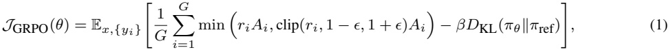
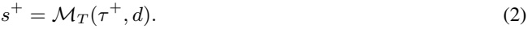
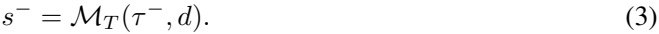
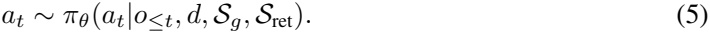
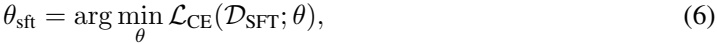
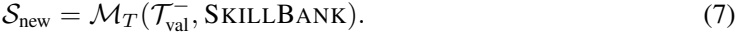
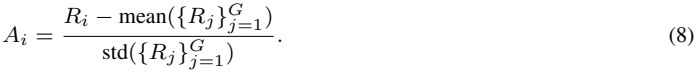
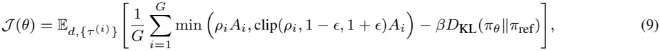
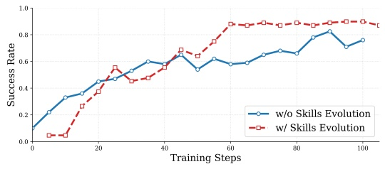

# SKILLRL: Evolving Agents via Recursive Skill-Augmented Reinforcement Learning

**Peng Xia**<sup>1∗</sup>**, Jianwen Chen**<sup>1∗</sup>**, Hanyang Wang**<sup>12∗</sup>**, Jiaqi Liu**<sup>1</sup>**, Kaide Zeng**<sup>1</sup>, **Yu Wang**<sup>3</sup>**, Siwei Han**<sup>1</sup>**, Yiyang Zhou**<sup>1</sup>**, Xujiang Zhao**<sup>4</sup>**, Haifeng Chen**<sup>4</sup>, **Zeyu Zheng**<sup>5</sup>**, Cihang Xie**<sup>6</sup>**, Huaxiu Yao**<sup>1</sup>

<sup>1</sup>UNC-Chapel Hill, <sup>2</sup>University of Chicago, <sup>3</sup>UC San Diego, <sup>4</sup>NEC Labs America, <sup>5</sup>UC Berkeley, <sup>6</sup>UC Santa Cruz

{pxia,huaxiu}@cs.unc.edu

## Abstract

Large Language Model (LLM) agents have shown stunning results in complex tasks, yet they often operate in isolation, failing to learn from past experiences. Existing memory-based methods primarily store raw trajectories, which are often redundant and noise-heavy. This prevents agents from extracting high-level, reusable behavioral patterns that are essential for generalization. In this paper, we propose SKILLRL, a framework that bridges the gap between raw experience and policy improvement through automatic skill discovery and recursive evolution. Our approach introduces an experience-based distillation mechanism to build a hierarchical skill library SKILLBANK, an adaptive retrieval strategy for general and task-specific heuristics, and a recursive evolution mechanism that allows the skill library to co-evolve with the agent’s policy during reinforcement learning. These innovations significantly reduce the token footprint while enhancing reasoning utility. Experimental results on ALFWorld, WebShop and seven search-augmented tasks demonstrate that SKILLRL achieves state-of-the-art performance, outperforming strong baselines over 15.3% and maintaining robustness as task complexity increases. Code is available at this [https://github.com/aiming-lab/SkillRL](https://github.com/aiming-lab/SkillRL).

## 1 Introduction

Large language model (LLM) agents [54, 34] have demonstrated remarkable capabilities across various sophisticated tasks [51, 15], such as web navigation [11, 27] and deep research [26, 10, 39], by interacting with complex environments through natural language. Despite these advances, each task execution remains largely episodic. Current LLM agents operate in isolation, unable to learn from past successes or failures [56], which significantly hinders their evolution. Consequently, a fundamental challenge remains: how can agents efficiently learn from experience and transfer that knowledge to other tasks?

The existing memory-based methods for LLM agents primarily involve saving raw trajectories directly into external databases during the sampling process to serve as references for similar future tasks [34, 58]. While intuitive, these raw trajectories are often lengthy and contain significant redundancy and noise [4], making it difficult for the model to extract critical information. Recent work has attempted to compress trajectories and update the memory bank via online training [56, 57], improving memory efficiency. However, these methods merely mimic past solutions and they fail to distill core principles or adapt the agent’s internal policy to leverage memory for guided decision-making. As depicted in the dashed flow of Figure 1(a), such approaches often struggle with

40th Conference on Neural Information Processing Systems (NeurIPS 2026).

<small><span class="docvortex-page-footnote" data-block-type="page_footnote" style="color:#6b7280"><sup>∗</sup>Equal Contribution.</span></small>

the trade-off between information density and noise, leading to sub-optimal performance or even degradation as shown in Figure 1(b).

We argue that these approaches miss a crucial insight: effective experience transfer requires abstraction. Human experts do not memorize every action in every situation; instead, they develop skills [2], compact and reusable strategies that capture the essence of how to accomplish specific subtasks. Inspired by this observation, we propose SKILLRL, a framework that bridges the gap between raw experience and efficient policy improvement through automatic skill discovery and recursive skill evolution.


<details>
<summary>image content</summary>

Memory        Skills
Trajectory        Expert
Base
Model   Environment
Evolve
Discard
(a)
Higher Performance
Faster Convergence
(b)
</details>

Figure 1: (a) Overview of the SKILLRL pipeline. Unlike previous methods (gray dashed lines) that store raw trajectories and discard failures, SKILLRL employs an experiencebased distillation mechanism to transform diverse experiences into structured skills. (b) Performance on ALFWorld validation set. SKILLRL achieves faster convergence and superior success rates compared to vanilla GRPO and memoryaugmented RL.

knowledge source. By analyzing failure modes after each validation epoch to generate new skills or refine existing ones, our approach ensures the skill library and the agent’s policy co-evolve, maintaining robustness as task complexity increases. As demonstrated in Figure 1(b), SKILLRL achieves substantially faster convergence and higher asymptotic performance.

SKILLRL first introduces an experience-based skill distillation mechanism, which gathers diverse trajectories from environment rollouts and applies differential processing: successful episodes are preserved as demonstrations, while failed ones are synthesized into concise failure lessons to mitigate context noise. Secondly, we transform these experiences into a hierarchical skill library SKILLBANK, differentiating between general skills for universal strategic guidance and task-specific skills for task-level heuristics. This abstraction allows the agent to adaptively retrieve relevant skills during decision-making, significantly reducing the token footprint while enhancing reasoning utility. Lastly, SKILLRL incorporates a recursive skill evolution mechanism during reinforcement learning (RL), where the skill library is treated as a dynamic component rather than a static

The primary contribution is SKILLRL, a framework that enables LLM agents to bridge the gap between raw experience and policy improvement through automatic skill discovery and recursive evolution. By distilling redundant trajectories into a hierarchical SKILLBANK, our method abstracts general and task-specific skills to guide decision-making efficiently. Furthermore, we introduce a recursive evolution mechanism that ensures the skill library and agent policy co-evolve during reinforcement learning. Empirical results on ALFWorld, WebShop, and seven search-augmented benchmarks demonstrate that SKILLRL achieves state-of-the-art performance with 15.3% improvements, significantly outperforming current memory-based agent-tuning baselines in both task success and reasoning utility.

## 2 Preliminaries

**LLM Agents.** We consider an agent operating in an interactive environment E. At each timestep t, the agent observes a state o<sub>t</sub> ∈ O, selects an action a<sub>t</sub> ∈ A, and receives a reward r<sub>t</sub> and next observation o<sub>t+1</sub>. A trajectory τ = (o<sub>0</sub>, a<sub>0</sub>, r<sub>0</sub>, . . . , o<sub>T</sub> , a<sub>T</sub> , r<sub>T</sub> ) captures one episode of interaction. Tasks are specified by natural language descriptions d. An LLM-based agent parameterized by θ implements a policy π<sub>θ</sub>(a<sub>t</sub>|<sup>o</sup>≤t, d, c) where c represents additional context (e.g., skills, demonstrations). Our goal is to learn a policy that maximizes expected return max<sub>θ</sub> E<sub>τ</sub>∼π<sub>θ</sub> hPT t=0 γ trti subject to context length constraints |c| ≤ L<sub>max</sub>.


<details>
<summary>image content</summary>

Successful Episodes
a1 a2 ⋯ an
Lessons from Failure
Base Model      Environment        Trajectory
Memory
Take what you see
Skills
Cold Start
Prioritize exploring
General Skills
unvisited nodes
For cleaning tasks,
Evolved Model     Environment
SFT Model      Task-Specific Skills
follow this process:
Locate -> Obtain ->
Clean the pool ->
Place this item
Update SkillBank        Create New or Refine
</details>

Figure 2: Overview of the SKILLRL framework. We collect trajectories using a base model, distill them into a hierarchical skill library, perform cold-start SFT to enable skill utilization, and then conduct RL training with dynamic skill evolution based on validation failures.

**Group Relative Policy Optimization (GRPO).** GRPO [33] is a reinforcement learning method that avoids training a critic by using intra-group relative rewards to optimize the policy. For each query x, the model samples G responses {y(<sup>1</sup>), . . . , y(<sup>G</sup>)}, which are scored to obtain rewards {R<sub>1</sub>, . . . , R<sub>G</sub>}. GRPO computes normalized advantages and updates the policy with a PPO-style clipped objective [32]:



Ri−mean({Rj}G j=1) is the normalized advantage, ϵ, β where ri = <u>πθ(yi|x)</u> is the importance ratio, Ai = πold(yi|x) std({Rj}G j=1) are hyperparameters, and <sup>π</sup>old is the policy before the current update.

## 3 SKILLRL

In this section, as illustrated in Figure 2, we propose SKILLRL, a framework designed to bridge the gap between raw interaction experience and policy improvement through automatic skill discovery and recursive evolution. SKILLRL consists of three core components. First, we develop an experience-based skill distillation mechanism to transform redundant trajectories into concise, actionable knowledge. Second, we organize these distilled experiences into a hierarchical skill library S, enabling efficient retrieval of general and task-specific expertise. Lastly, we introduce a recursive skill evolution mechanism that leverages RL to dynamically refine the skill library in tandem with the agent’s policy. We detail these components as follows:

## 3.1 Experience-based Skill Distillation

Raw trajectories τ collected from environment interactions are verbose, containing exploratory actions, backtracking, and redundant steps that obscure the critical decisions leading to success or failure. To transform these experiences into actionable knowledge, we employ a teacher model M<sub>T</sub> to distill trajectories into compact, reusable skills.

Specifically, we first deploy a base LLM agent <sup>π</sup>base in the target environment E to collect diverse trajectories. Unlike prior approaches that retain only successful episodes, we deliberately preserve both successful trajectories T+ = {τi : r(τi) = 1} and failed trajectories T− = {τi : r(τi) = 0}, where r(τ ) denotes the binary task success indicator. Failed trajectories reveal failure modes and boundary conditions, i.e., information difficult to infer from successes alone.

We apply differential processing based on trajectory outcomes. For successful trajectories τ+ ∈ T +, we extract the strategic patterns that led to task completion:



The teacher model identifies critical decision points, the reasoning behind correct actions, and generalizable patterns that transfer beyond the specific task instance.

For failed trajectories τ− ∈ T −, direct inclusion in context is infeasible due to their length and noise. Instead, we synthesize concise failure lessons:



The analysis identifies: (1) the point of failure, (2) the flawed reasoning or action, (3) what should have been done, and (4) general principles to prevent similar failures. This transforms verbose failed episodes into counterfactuals.

## 3.2 Hierarchical Skill Library (SKILLBANK) Construction

Following the design principles of Agent Skills [2], we organize the distilled knowledge into a hierarchical skill library SKILLBANK that enables efficient retrieval of relevant expertise during decision-making.

**Skill Organization.** We structure SKILLBANK into two levels: 1) General Skills S<sub>g</sub> capture universal strategic principles applicable across all task types within an environment. These typically include exploration strategies (e.g., systematic search patterns, prioritizing unvisited locations), state management principles (e.g., verifying preconditions before actions), and goal-tracking heuristics (e.g., maintaining progress counters, terminating only upon verified completion). General skills provide foundational guidance that transfers across different task categories. 2) Task-Specific Skills S<sub>k</sub> encode specialized knowledge for task category k. These capture domain-specific action sequences, task-particular preconditions and constraints, common failure modes unique to the task type, and optimized procedures that exploit task structure. By organizing trajectories by task type during collection, we enable extraction of fine-grained, category-specific strategies that complement the broader general skills.

The complete skill library SKILLBANK is Sg ∪ SK k=1 Sk. Each skill s ∈ SKILLBANK is structured with: a concise name (e.g., systematic exploration), a principle describing the strategy, and when\_to\_apply conditions specifying applicability. This format enables efficient retrieval while providing clear guidance for application.

**Skill Retrieval.** At inference, given a task description d, the agent retrieves relevant skills to augment its context. General skills S<sub>g</sub> are always included as foundational guidance. Task-specific skills are retrieved via semantic similarity:


where e<sub>d</sub>, e<sub>s</sub> are embeddings of the task description and skill respectively, δ is a similarity threshold, and K controls the number of retrieved skills. The policy then conditions on the retrieved skills:



Notably, skill distillation achieves 10–20× token compression compared to raw trajectories while enhancing rather than degrading the utility of the original experience. This compression allows the agent to leverage rich experiential knowledge within limited context windows.

## 3.3 Recursive Skill Evolution

A static skill library cannot anticipate all scenarios the agent will encounter. As the policy improves and explores new state regions, it faces situations where existing skills provide insufficient guidance. We introduce recursive skill evolution during reinforcement learning to address this limitation, enabling the skill library and agent policy to co-evolve.

**Cold-Start Initialization.** Before RL training, we address a critical challenge: the base agent has not learned how to effectively utilize skills. Simply providing skills to an unchanged model yields limited benefit [12]. We therefore perform a cold-start supervised fine-tuning (SFT) stage [28], where the teacher model MT generates N skill-augmented reasoning traces DSFT = {(di, Si, τ ∗ i )}N i=1 demonstrating how to retrieve, interpret, and apply skills during decision-making. The base model is then fine-tuned on these demonstrations:



where LCE denotes the cross-entropy loss. The resulting model πθsft serves as both the starting point for RL training and the reference policy <sup>π</sup>ref for KL regularization.

**Recursive Skill Evolution.** A static skill library cannot anticipate all scenarios the agent will encounter. As the policy improves and explores new state regions, it faces situations where existing skills provide insufficient guidance. We introduce recursive skill evolution to address this limitation. The process begins with an initial skill library containing baseline task-action principles.

After each validation epoch, we monitor the success rate Acc(C) for each task category C. To ensure targeted growth, the evolution is triggered only for categories where Acc(C) < δ. We then collect failed trajectories T− val = {τj : r(τj ) = 0}M j=1 using a diversity-aware stratified sampling strategy: trajectories are grouped by category, prioritized by the severity of failure (negative rewards), and selected via round-robin sampling to maintain categorical entropy. Then we will analyze these samples to identify gaps:



The teacher model is prompted to: (1) identify failure patterns not addressed by current skills, (2) propose new skills to cover these gaps, and (3) suggest refinements to existing skills that proved ineffective. The library is then updated: SKILLBANK ← SKILLBANK ∪ S<sub>new</sub>.

This creates a virtuous cycle: as the agent improves, it encounters new challenges, which drive skill library expansion, which enables further improvement.

**RL-based Policy Optimization.** We optimize the skill-augmented policy using GRPO. For each task with description d, the agent first retrieves relevant skills and then samples G complete trajectories {τ(1), . . . , τ (G)} from the current policy π<sub>θ</sub>. Each trajectory τ(i) receives a binary reward R<sub>i</sub> = r(τ(<sup>i</sup>)) ∈ {0, 1} indicating task successfulness. The normalized advantage for each trajectory is computed as:



The policy is updated according to:



is the importance ratio computed over the skill-augmented context. The

where ρ<sub>i</sub> = πθ(τ (i) |d,Sg,Sret) π<sub>old</sub>(τ(<sup>i</sup>)|d,S<sub>g</sub>,S<sub>ret</sub>)

KL penalty anchored to πref = πθsft ensures that RL optimization preserves the learned skill utilization capabilities while improving task performance. The complete training procedure is summarized in Algorithm 1.

## 4 Experiments

We evaluate SKILLRL on nine challenging benchmarks for LLM agents: ALFWorld, WebShop, and seven search-augmented QA tasks. Our experiments address the following questions: 1) How does SKILLRL compare to state-of-the-art methods? 2) What is the contribution of each component? 3) How does the skill library evolve during training? 4) Does skills accelerate model convergence?

## 4.1 Experimental Setup

**Environments.** ALFWorld [35] is a text-based game aligned with the ALFRED embodied AI benchmark. Agents must complete household tasks by navigating and interacting with objects through text commands. WebShop [53] simulates web shopping. Agents navigate a realistic web interface to find and purchase products matching user specifications. In addition, we also evaluate the performance of SKILLRL on search-augmented QA tasks, including single-hop QA datasets (NQ [18], TriviaQA [17], and PopQA [23]) and multi-hop QA datasets (HotpotQA [52], 2Wiki [13], MuSiQue [41], and Bamboogle [31]).

**Baselines.** We compare SKILLRL against four categories of competitive methods. First, we include closed-source LLMs, specifically GPT-4o [24] and Gemini-2.5-Pro [5], which represent the state-of-the-art in general-purpose reasoning and instruction following. Second, we evaluate prompt-based agentic or memory-based methods, including ReAct [54] and Reflexion [34], which rely on in-context prompting for multi-step reasoning, as well as Mem0 [4], ExpeL [58], and MemP [7], which utilize external memory or experience pools to guide behavior without parameter updates. Third, we consider RL-based methods, including group-based online RL algorithms such as RLOO [1] and GRPO [33] that optimize policies via advantage estimation over trajectory groups. Finally, we compare against memory-augmented RL-based methods, such as EvolveR [49], MemRL [57], and the combination of Mem0+GRPO and SimpleMem [22]+GRPO, which integrate persistent memory mechanisms directly into the reinforcement learning optimization process to handle long-term dependencies. For search-augmented QA, we compare SKILLRL with R1-Instruct, Search-o1 [20], Search-R1 [16], ZeroSearch [36], and StepSearch [59].

Table 1: Performance on ALFWorld and WebShop. For ALFWorld, we report the average success rate (%) for each subtask as well as the overall result. For WebShop, we report both the average score and the average success rate (%). ∗ denotes the results replicated from [8]. The best results and second best results are highlighted in red and blue , respectively.

```
Method                                      ALFWorld                             WebShop
                       Pick   Look    Clean    Heat    Cool    Pick2    All    Score   Succ.
Closed-source LLMs
GPT-4o                 75.3   60.8     31.2    56.7    21.6    49.8    48.0    31.8     23.7
Gemini-2.5-Pro         92.8   63.3     62.1    69.0    26.6    58.7    60.3    42.5     35.9
Qwen2.5-7B-Instruct
Qwen2.5                33.4   21.6     19.3    6.90    2.80    3.20    14.8    26.4     7.80
Prompt-based Agentic or Memory-based Methods
ReAct∗                 48.5   35.4     34.3    13.2    18.2    17.6    31.2    46.2     19.5
Reflexion∗             62.0   41.6     44.9    30.9    36.3    23.8    42.7    58.1     28.8
Mem0                   54.0   55.0     26.9    36.4    20.8    7.69    33.6    23.9     2.00
ExpeL                  21.0   67.0     55.0    52.0    71.0    6.00    46.3    30.9     11.2
MemP                   54.3   38.5     48.1    56.2    32.0    16.7    41.4    25.3     6.40
SimpleMem              64.5   33.3     20.0    12.5    33.3    3.84    29.7    33.2     8.59
RL-based Methods
RLOO∗                  87.6   78.2     87.3    81.3    71.9    48.9    75.5    80.3     65.7
GRPO∗                  90.8   66.1     89.3    74.7    72.5    64.7    77.6    79.3     66.1
Memory-Augmented RL-based Methods
MemRL                  62.8   38.5     22.2    12.5    8.00    0.00    21.4    29.5     9.20
EvolveR                64.9   33.3     46.4    13.3    33.3    33.3    43.8    42.5     17.6
Mem0+GRPO              78.1   54.8     56.1    31.0    65.0    26.9    54.7    58.1     37.5
SimpleMem+GRPO         89.5   36.3     60.0    50.0    64.9    26.3    62.5    67.8     46.9
SKILLRL                97.9   71.4     90.0    90.0    95.5    87.5    89.9    85.2     72.7
```

Table 2: Performance on search-augmented QA tasks. SKILLRL is trained on NQ and HotpotQA. † and ⋆ indicate in-domain and out-of-domain datasets, respectively. ∗ denotes the results replicated from [36].

```
Method              Single-Hop QA                            Multi-Hop QA
              Avg. NQ†
                      TriviaQA⋆   PopQA⋆ HotpotQA† 2Wiki⋆           MuSiQue⋆ Bamboogle⋆
Qwen2.5-7B-Instruct
Qwen2.5∗      11.6       35.6       1.20        16.4        22.2       4.80         14.4        15.2
CoT∗          12.8       35.6       3.80        16.2        22.6       6.60         24.0        17.4
RAG∗          27.4       58.2       17.8        25.8        23.2       9.40         16.8        25.5
Search-o1∗    19.4       40.6       11.4        17.0        27.0       8.60         30.4        22.1
R1-Instruct   21.0       44.9       17.1        20.8        27.5       6.00         19.2        22.4
Search-R1     39.3       61.0       39.7        37.0        40.1       14.6         36.8        38.5
ZeroSearch    43.6       61.8       51.5        34.6        35.2       18.4         27.8        39.1
StepSearch      -         -           -         38.6        36.6       22.6         40.0         -
EvolveR       43.5       63.4       44.6        38.2        42.0       15.6         54.4        43.1
SKILLRL       45.9       63.3       45.9        43.2        40.3       20.2         73.8        47.1
```

**Implementation Details.** We use Qwen2.5-7B-Instruct [3] as our base model and OpenAI o3 [25] as the teacher model for skill distillation and SFT data generation. For RL training, we use GRPO with learning rate 1 × 10<sup>−6</sup>, batch size 16, group size 8, and 4 gradient accumulation steps. We set K = 6 for task-specific skill retrieval and δ = 0.4 for the collection of failed trajectories. For more detailed information on training hyperparameters, please see Appendix D.1.

## 4.2 Main Results

**Comparison with Baselines.** We compare SKILLRL with baselines across two benchmarks as shown in Table 1. Our method consistently outperforms all baselines, with key observations as follows:

1) Significant Gains over Prompt-based Methods. SKILLRL achieves a 89.9% success rate on ALFWorld and 72.7% on WebShop, outperforming the best prompt-based baselines by a large margin. This gap suggests that while in-context learning can leverage past experiences, it often fails to distill actionable knowledge from verbose trajectories or fundamentally adapt the agent’s policy.

2) Superiority over Vanilla RL. RL training brings substantial gains, yet SKILLRL consistently surpasses standard RL baselines. Compared to PPO, RLOO, and GRPO, SKILLRL achieves the best overall performance. Notably, since SKILLRL utilizes GRPO as its base optimizer, the 12.3% absolute improvement over GRPO on ALFWorld (from 77.6% to 89.9%) is directly attributable to our skill-augmentation mechanism rather than algorithmic variance. In complex subtasks like Cool and Pick2, SKILLRL outperforms GRPO by 23.0% and 22.8% respectively, proving that structured skill priors effectively accelerate and enhance policy learning in sparse-reward environments.

3) Advantage over Memory-Augmented RL. SKILLRL substantially outperforms existing memoryaugmented RL frameworks, which differ in how they manage and update experience. MemRL, which uses RL solely to update its memory bank while keeping the policy frozen, fails to adapt to complex environments, yielding only 21.4% on ALFWorld. EvolveR, which jointly updates the policy and memory bank, shows improvement (43.8%) but remains limited by its reliance on rough trajectory storage. To provide a more competitive baseline, we implemented Mem0+GRPO, which combines a state-of-the-art prompt-based memory mechanism with an optimized policy model. While this hybrid approach improves performance to 54.7% on ALFWorld and 37.5% on WebShop, it still trails SKILLRL by a wide margin (about 35.2% absolute success rate gap). These results validate our core hypothesis: effective experience transfer requires high-level skill abstraction and a co-evolving library rather than simple trajectory compression or prompt-based memory retrieval.

**Comparison with Closed-Source Models.** Remarkably, SKILLRL with Qwen2.5-7B-Instruct significantly outperforms much larger closed-source models, as shown in Table 1. On ALFWorld, our method exceeds GPT-4o [24] by 41.9% and Gemini-2.5-Pro [5] by 29.6%. This demonstrates that effective skill learning can compensate for model scale, enabling smaller open-source models to achieve superior task performance through structured experiential knowledge.

**Performance on Search-Augmented QA.** As shown in Table 2, SKILLRL achieves a state-of-the-art average score of 47.1%, significantly outperforming Search-R1 (38.5%) abd EvolveR (43.1%). Key observations include: 1) Superior multi-hop Reasoning: SKILLRL excels in complex tasks like Bamboogle, surpassing EvolveR by 19.4%. This demonstrates that hierarchical skills effectively guide multi-step information synthesis. 2) Strong generalization: Despite being trained on limited datasets (NQ, HotpotQA), SKILLRL maintains competitive performance on OOD tasks like TriviaQA and 2Wiki, confirming that distilled search strategies are task-agnostic.

## 4.3 Analysis

In this section, we provide detailed analysis of each module’s effectiveness and the skill evolution dynamics.

**Ablation Studies.** We conduct ablation experiments to evaluate each component’s contribution, with results in Table 3. According to the results: (1) Removing hierarchical structure (i.e., task-specific skills only) decreases performance by 13.1% on ALFWorld and 11.3% on WebShop, indicating universal strategic principles provide essential foundational guidance. (2) Replacing the skill library with raw trajectories causes the largest degradation (up to 25%), which directly supports our motivation that abstraction is superior to memorization. Raw experiences introduce significant redundancy and noise that hinder effective knowledge transfer. (3) Cold-start SFT proves critical (20% drop without it), confirming that the base model requires an initial explicit demonstration phase to learn how to adaptively retrieve and utilize the abstracted skills before entering the RL stage. (4) Dynamic evolution contributes a 5.5% improvement by ensuring the skill library is a dynamic component rather than a static database. This co-evolution allows the agent to iteratively refine its internal policy by addressing emergent failure modes that were not covered by the initial skill set.

Table 3: Ablation study results. Average success rate (%) on ALFWorld and WebShop.

```
Method            ALFWorld WebShop
SKILLRL              89.9         72.7
Skill Library Ablations
   w/o Hier.         76.8         61.4
   w/o Skill Lib.    61.7         50.2
Training Pipeline Ablations
   w/o SFT           65.2         46.5
   w/o Dyn.          84.4         70.3
```


Figure 4: Comparison of prompt length between raw memory retrieval and our distilled skill abstraction. SKILLRL consistently reduces context overhead while maintaining reasoning utility.



Figure 5: Success rate on ALFWorld validation set. The recursive skill evolution significantly accelerates convergence and enhances the overall performance ceiling.

**Per-Task Analysis on ALFWorld.** Table 1 breaks down ALFWorld performance by task type. The largest gains are on PickTwo (+23%), Cool (+22%) and Heat (+15%), which are among the most challenging tasks requiring multi-step planning and state tracking. Task-specific skills are particularly valuable here, capturing strategies like “when picking two objects, verify the first is secured before searching for the second” that address common failure modes.

**Skill Library Growth.** Figure 3 shows how the skill library evolves during training. The initial skill library contains 55 skills (12 general, 43 task-specific). Through dynamic evolution, this grows to 100 skills by the end of training (Step 150). The growth is predominantly driven by task-specific skills (increasing from 43 to 80), while general skills show a steadier increase (from 12 to 20). Notably, we observe a balanced expansion across various task categories, ensuring the agent develops specialized expertise for each environment rollout. This overall expansion reflects the agent’s increasing ability to refine its repertoire and tackle diverse scenarios within specific task types.

**Skill Library Evolution**

```
Total Skills   Heat
General        Cool
Pick           Pick2
Look           Mistakes
Clean                                                              100
                                                           94
                                                   88
                                          83
                                  77
                         71
                 66
         60
55
```

120

100

Number of Skills

80

60

40

20

## 0 0 20 40 60 80 100 120 140 150

**Training Steps**

Figure 3: Evolution of skill library size during RL training.

context than the memory-based baseline to achieve superior performance, demonstrating that skill abstraction effectively mitigates the context-bloat problem common in traditional memory-based agents.

**Context Efficiency.** To evaluate the impact of skill abstraction on inference overhead, we compare the average prompt length of SKILLRL with a memory-augmented baseline using raw trajectories (Qwen2.5-7B with Raw Memory) in Figure 4. The results reveal that while the raw memory approach suffers from a high and fluctuating token footprint (averaging ∼1,450 tokens), SKILLRL maintains a significantly leaner prompt (averaging <1,300 tokens), achieving approximately a 10.3% reduction in context length. This efficiency stems from our distillation mechanism, which compresses verbose environment interactions into high-density, actionable skills. Notably, SKILLRL requires less

**Evolution Dynamics.** Figure 5 illustrates the reinforcement learning training curves with and without the recursive skill evolution mechanism. We observe that while SKILLRL without evolution shows steady improvement, SKILLRL with skill evolution exhibits a notably higher learning rate and superior asymptotic performance. Specifically, SKILLRL achieves a success rate of over 80% within 60 training steps, whereas the baseline requires approximately 90 steps to reach a lower peak. This acceleration in convergence suggests that the dynamic introduction of new skills and refinement of existing ones effectively provide the agent with timely strategic guidance to overcome local optima.


<details>
<summary>image content</summary>

WebShop        ALFWorld
Task: I need a women's long sleeve button-down shirt in navy blue, size large,
Task: heat some egg and put it in countertop.
machine washable, price lower than $40.00
--- Retrieved Skills ---
--- Retrieved Skills ---
Detected Task Type: heat
Detected Task Type: apparel
[General Skills] … [Task-Specific Skills]
[General Skills] … [Task-Specific Skills]------
------
Step 1
Step 1
Observation: You are in the middle of a room. Looking quickly around you…
Observation: WebShop homepage. Search bar available.
<think>Per [gen_010] 'Progressive Goal Decomposition': sub-goals are … Per [hea_004]
<think>Following skill [gen_001] 'Prioritize Core Keywords' and [app_001] 'Focus Key
'No Appliance Before Object': I must NOT go to microwave first. Per [hea_001]
Query': I should include product type + must-have attributes. My query should be …</think>
'Secure Exact Target First': find the egg. It's food — check fridge and
…        …
<action>search[women long sleeve button down shirt navy blue machine …]</action>
countertops.</think>
Step 9
<action>go to countertop 1</action>
Observation: Product page updated: Color = Navy Blue, Size = L. Price: $29.99
Step 8
<think>Applying skill [app_004] 'Check Variant Price': price for Navy Blue / L is $29.99,
Observation: You arrive at countertop 1
which is under the $40 budget. Also per [app_005] 'Confirm Hidden Specs': … $29.99 <
<think>Per [hea_005]: place the heated egg directly.</think>
$40. Per skill [gen_013] 'Purchase Decisively', I should buy now.</think>
<action>click[Buy Now]</action>        <action>put egg 1 in/on countertop 1</action>
</details>

Figure 6: Case studies of SKILLRL on WebShop and ALFWorld. The examples illustrate how the agent adaptively retrieves and integrates General Skills and Task-Specific Skills within its reasoning process to achieve precise and efficient task execution.

Furthermore, the higher performance ceiling validates that the co-evolution of the skill library and the policy allows the agent to adapt to increasingly complex task scenarios that static memory methods fail to resolve.

**Qualitative Analysis.** To further investigate how SKILLRL utilizes the learned knowledge, we visualize the reasoning process on ALFWorld and WebShop in Figure 6. The case studies demonstrate that our trained agent can effectively retrieve and execute relevant skills from the SKILLBANK to guide its decision-making. For instance, in the WebShop task, the agent invokes general strategies like “Prioritize Core Keywords” alongside task-specific heuristics “Focus Key Query” to ensure the product meets all constraints within a limited budget. Similarly, in ALFWorld, the agent coordinates hierarchical skills, i.e., using “Progressive Goal Decomposition” for high-level planning and “No Appliance Before Object” to avoid common logical pitfalls. This seamless integration of general and specific skills confirms that the agent does not merely memorize trajectories, but rather develops a structured understanding of task logic, allowing for more robust and efficient problem-solving.

## 5 Related Work

**LLM Agents.** The emergence of capable LLMs has catalyzed rapid development in autonomous agent systems [47]. ReAct [54] interleaves reasoning and acting, enabling chain-of-thought style planning during interaction, while Reflexion [34] introduces verbal reinforcement through self-reflection on past failures. Frameworks like AutoGen [48] and CAMEL [19] demonstrate general-purpose multi-agent capabilities, featuring automated orchestration and diverse tool integration. While initial efforts focused on constrained tasks like coding or basic arithmetic, these approaches primarily rely on in-context learning (ICL) [6]. However, these agents struggle to scale as tasks become more complex, as they treat every interaction as an isolated event and must start each new task from scratch without any prior knowledge.

**Memory Mechanisms in Agents.** To overcome the limitations of finite context windows and the inability of agents to learn from experience, external memory architectures have become a cornerstone of agent design [14]. Early systems primarily utilized a static RAG paradigm or stored raw trajectories as few-shot examples [42, 4, 55, 45]. However, raw trajectories are often token-heavy and contain significant redundancy and noise, which can lead to performance degradation. Current research has moved toward self-improving memory, distilling interactions into higher-level insights or procedural tips [43, 37, 7, 58, 29, 46]. While some recent work explores updating memory banks via online training to improve efficiency [56, 57], many existing methods still struggle to distinguish high-value experiences from noise or fail to distill core principles that can guide internal decision-making.

**Evolution of Agentic Skills and Reinforcement Learning.** The development of agentic skills [2], which are compact, reusable strategies that capture the essence of subtasks, is increasingly viewed through the lens of Continual Learning (CL) and RL. Traditional CL [30] focuses on knowledge preservation in predefined tasks, but self-evolving agents [9, 50, 21] aim for active skill acquisition in open-ended environments [7, 44]. While RL is widely used to align LLMs [32, 28], or improve reasoning via rule-based verifiers [33], applying it to agentic skills remains challenging due to sparse rewards and long horizons. Unlike previous memory-augmented RL which treats memory as a